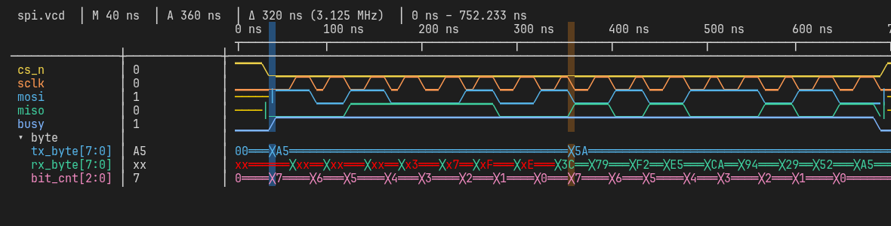
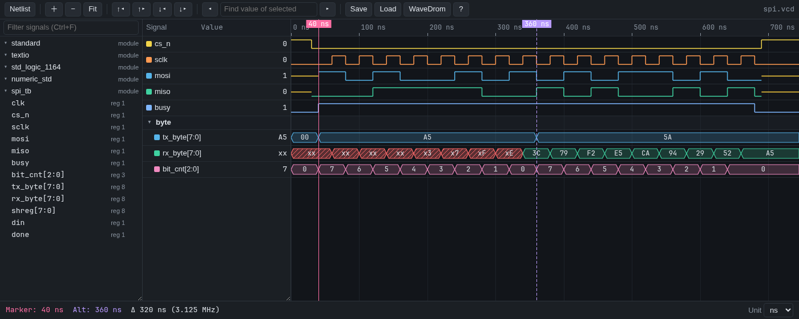
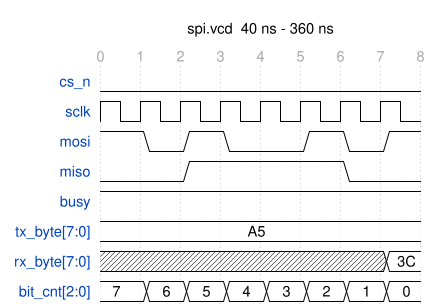
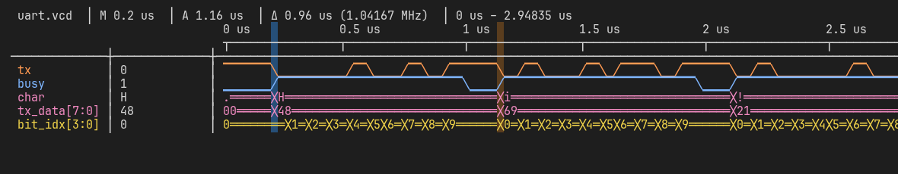
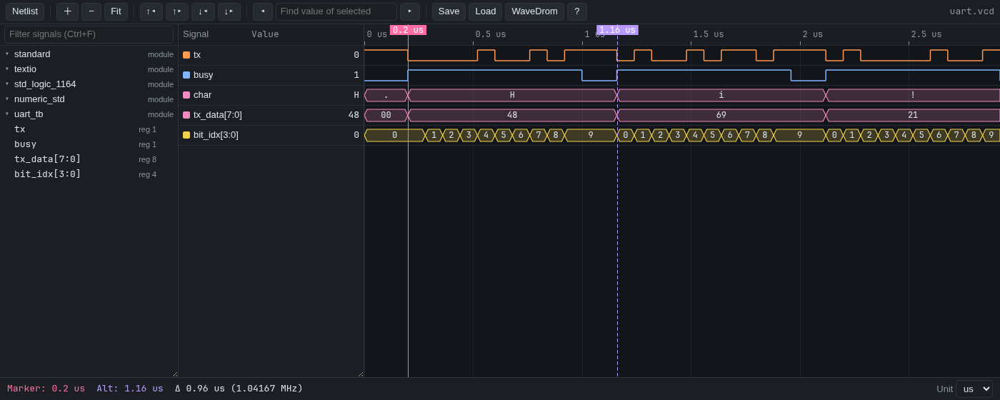
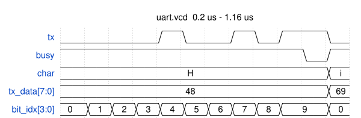
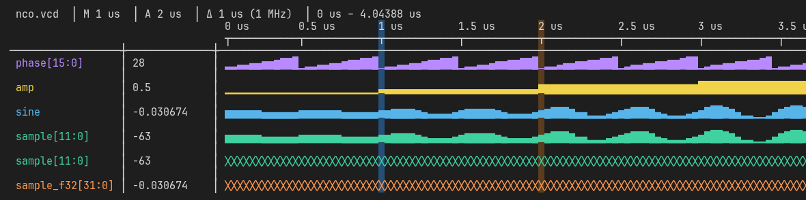
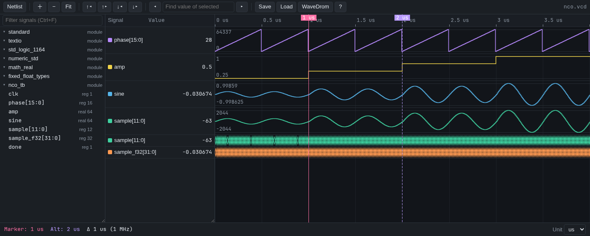
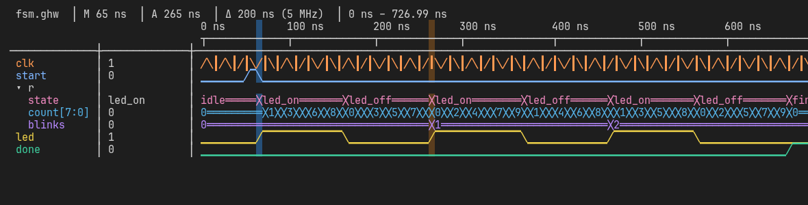
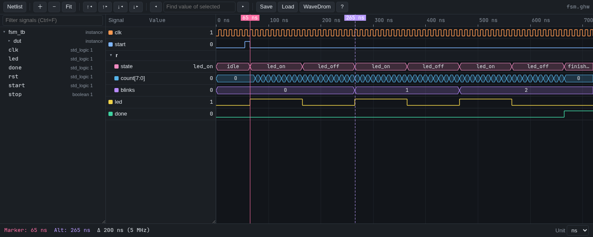

#+TITLE: evaporview examples
#+STARTUP: inlineimages

Four small GHDL testbenches, each dumped with a curated session next
to it.  =M-x evaporview-open= on any dump here loads that session on its
own: signals, formats, colors, groups and both markers.  =make try= in the
repository root opens the SPI example with its netlist and a WaveDrom preview.

| Example | Testbench      | Shows                                                        |
|---------+----------------+--------------------------------------------------------------|
| SPI     | =spi_tb.vhd=   | mode 0 transfer, groups, clocked WaveDrom export via ewavedrom |
| UART    | =uart_tb.vhd=  | "Hi!" on a serial line, ASCII format, unclocked WaveDrom      |
| NCO     | =nco_tb.vhd=   | sine NCO with an amplitude ramp: analog, signed, real, float32 |
| FSM     | =fsm_tb.vhd=   | two-process design: records and an enum state, from GHW        |

Images are rebuilt with =make showcase=; the dumps and sessions with
=make examples=.

* SPI: a mode 0 transfer

The master sends =A5= then =5A=.  The slave starts out holding =3C= and
echoes back what it receives, so =rx_byte= ends the first byte as =3C= and
the second as =A5=.  Before its last bit, =rx_byte= still carries the
undefined bits it started with, which is why it draws as =x=.

Emacs (text, works over SSH):

Browser (=B=):

The markers bracket the first byte.  =C-u W=, clock =spi_tb.sclk=, edge
=rise= samples every signal on each rising SCLK edge, and ewavedrom draws it:

Things to try in the waveform buffer:

- Put point on =sclk= and press =]= repeatedly: the marker walks the rising
  edges, and the value column shows MOSI and MISO at each one.
- Put point on =rx_byte=, press =/= and type =A5=: the marker jumps to the
  moment the echo completes.
- =TAB= on the =byte= group folds it; =S= on =tx_byte= with =1= splits it
  into its eight bits.
- =C-c C-w= copies the same diagram as an Org =wavedrom= block.

* UART: "Hi!" at 12.5 MBd

Each character is a start bit, eight data bits LSB first and a stop bit, 80 ns
per bit.  The same =tx_data= bus is shown twice, once as ASCII (renamed
=char=) and once as hex.

The markers span exactly one character frame plus the idle gap, so the header
reads =0.96 us=.  =W= without a prefix makes every value change an event:

- On =tx=, =n= and =N= step bit by bit; =bit_idx= tells which bit you are on.
- =/= on =char= with =!= finds the last character.

* NCO: a sine with an amplitude ramp

A 16-bit phase accumulator drives =sin=; the amplitude steps from 0.25 to 1.0
every microsecond.  The output is kept three ways: a VHDL =real=, a 12-bit
=signed= sample, and its IEEE 754 single-precision bit pattern.

- =A= toggles a signal between digital and analog drawing.
- The second =sample= row is digital: =+= a few times shows each value.
- =sample_f32= is formatted =float=: the bit pattern decoded as IEEE 754,
  matching the =sine= row to six digits.
- =f= on =sample= with =unsigned= shows the two's-complement bits read the
  other way.

* FSM: a two-process design, read from GHW

=fsm_tb.vhd= is a blink controller in the two-process style: all state in a
record =reg_t= (=state=, =count=, =blinks=, =led=), held in =r= and computed
into =rin=.  GHDL's VCD output drops record signals without a warning, so the
same run as VCD holds only the ports and testbench signals.  The dump here is GHW
(=ghdl -r fsm_tb --wave=fsm.ghw=), which keeps them: =r= and =rin= appear in
the netlist under =dut= with their fields, and =state= shows its enumeration
literals by name.

The markers sit on two consecutive rising edges of =led=, so the header reads
=200 ns (5 MHz)=: ten clock cycles on, ten off.

- On =state=, =/= and =finished= jumps to the end of the third blink.
- =A= on =count= draws the counter's sawtooth.
- =l= opens the netlist: =rin= holds the next-state values, one cycle ahead of =r=.
